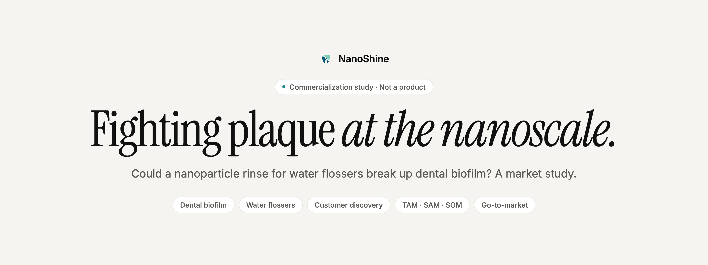
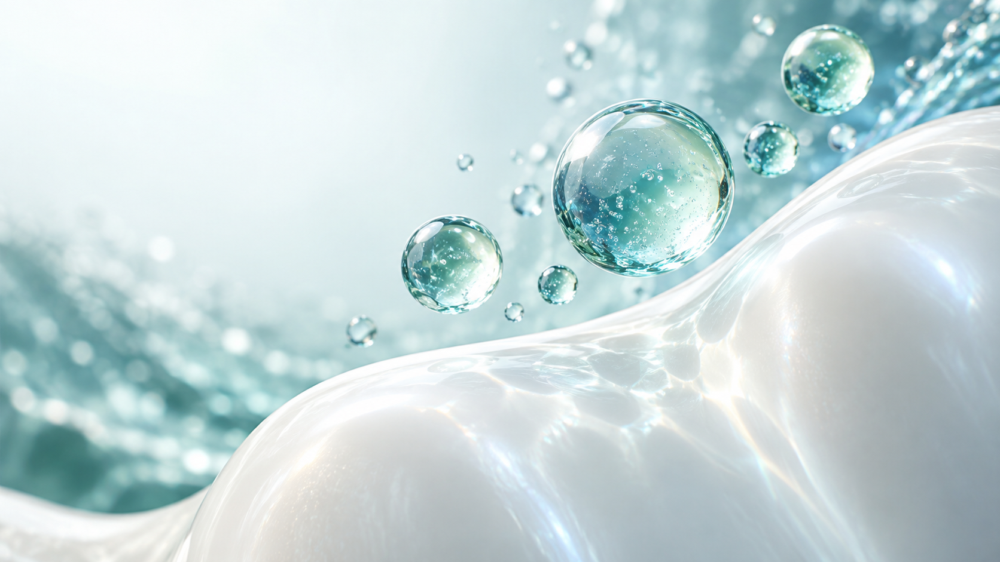
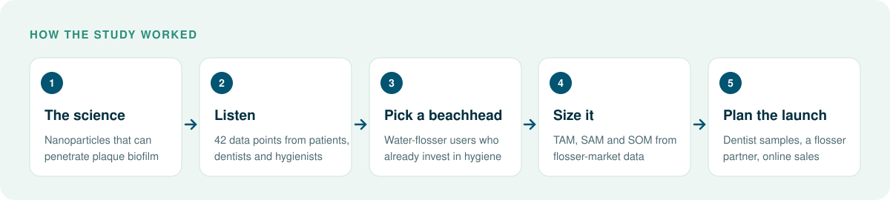
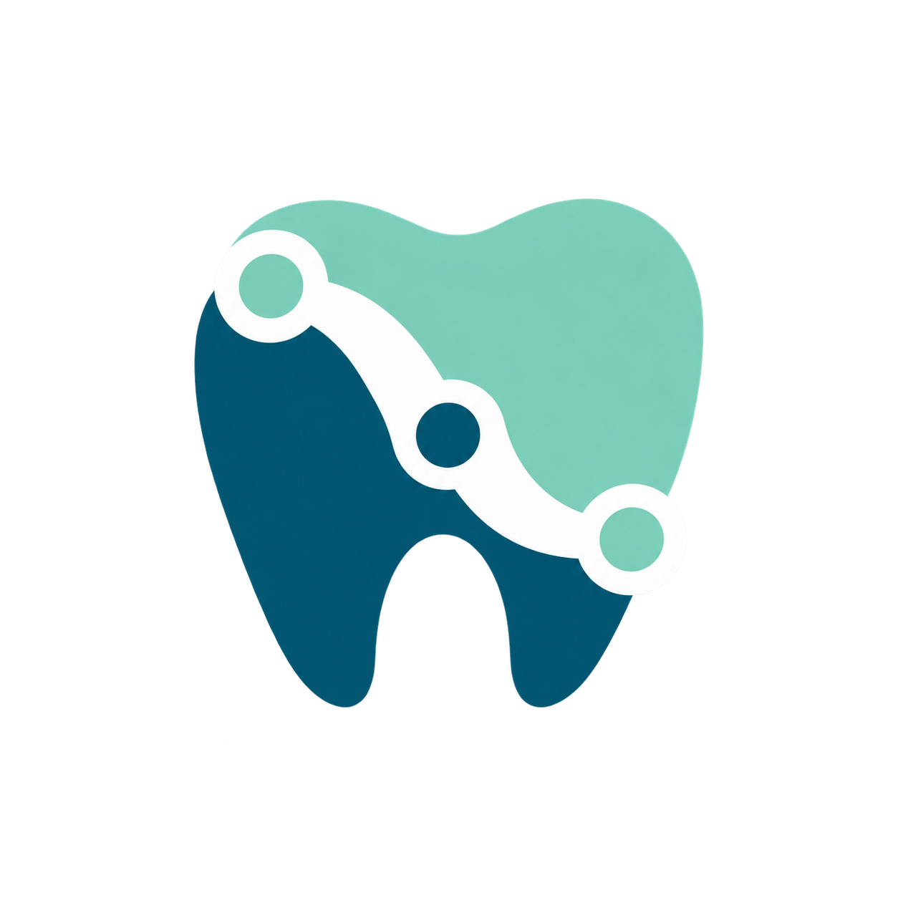

  <picture>
    <source media="(prefers-color-scheme: dark)" srcset=".github/assets/banner-dark.png">
    
  </picture>

  <strong>Could nanoparticles make your daily floss actually clear plaque?</strong> 
  NanoShine is a university commercialization study of a nanoparticle-based fluid for water flossers, from the science to customers, market size and launch plan.

  <a href="Final%20Presentation.pptx"><strong>Final presentation</strong></a> ·
  <a href="2_28%20Final%20Proposal.pdf"><strong>Proposal</strong></a> ·
  <a href="#what-the-team-found"><strong>Findings</strong></a> ·
  <a href="#whats-in-this-repository"><strong>Files</strong></a> ·
  <a href="#honest-status"><strong>Honest status</strong></a>

  
  
  
  

  
   <strong>Conceptual artwork,</strong> generated for this project. It does not show a real product or a measured result.

## Why NanoShine

Dental plaque is a biofilm: a sticky community of bacteria that brushing and flossing only partly remove. Once it hardens, even a hygienist's tools struggle. Water flossers are popular with people who care a lot about their teeth, yet almost all of them just use tap water.

**NanoShine asked a simple commercial question:** if nanoparticles can penetrate and break up biofilm, who would buy a product built on that, how would it reach them, and is the market big enough? The five-person student team, working in a university technology-commercialization course, answered it with customer interviews, a survey, market sizing and a financial model.

<table>
  <tr>
    <td width="33%" valign="top">
      <h3>🔬 Science first</h3>
      Background research on nanoparticles and dental biofilms, using course materials on a nanoparticle technology.
    </td>
    <td width="33%" valign="top">
      <h3>🗣️ Customer-led</h3>
      Interviews and a market survey with patients, dentists and hygienists shaped who the product is for.
    </td>
    <td width="33%" valign="top">
      <h3>📈 Numbers to test</h3>
      Market sizing, a six-year revenue and funding model, and a step-by-step go-to-market plan.
    </td>
  </tr>
</table>

## How the study worked

  

## What the team found

| Question | The team's answer (from the final presentation) |
| --- | --- |
| **Who first?** | "Extra oral hygiene advocates": North American water-flosser users, aged roughly 25–60, with good access to dental care |
| **What product?** | A concentrated nanoparticle fluid to add to a water flosser, with toothpaste and rinses as later extensions |
| **Who influences the purchase?** | Dentists and hygienists, who already educate patients about plaque at every cleaning |
| **Biggest competitor?** | The status quo: people flossing with plain tap or filtered water |
| **How big?** | A water-flosser market of about $827 million (the team's cited 2021–22 estimate), with two obtainable-market scenarios: flosser owners, and dentist and hygienist referrals |
| **How to launch?** | Samples through dentists, free demos, exclusive online sales, then retail and product-line expansion |

Market figures are the team's 2023 estimates from cited industry reports. They have not been updated or independently checked.

## What's in this repository

| Where | What it is |
| --- | --- |
| [`Final Presentation.pptx`](Final%20Presentation.pptx) | The final pitch: segment, patient journey, interviews, market size, competition, go-to-market, revenue model and appendices |
| [`2_28 Final Proposal.pdf`](2_28%20Final%20Proposal.pdf) | Commercialization proposal: technology background, customer segment, barriers, hypotheses and next steps |
| `Mid - Presentation.pptx`, `NanoShine - Initial Findings.pptx` | Earlier checkpoints |
| `TAM _ SAM _ SOM.docx`, `NanoShine - Market Survey (Responses).xlsx` | Market sizing and survey results |
| `NanoShine Consolidated Statement of Comprehensive Income.xlsx`, `OneCard Simple Financial Model.xlsx` | Financial models |
| `Final Submission/`, `Meeting notes/` | Interview responses and team meeting notes |
| `Archives/`, `blackboard materials/` | Drafts, feedback and the course's background readings on dental biofilms |
| [`assets/brand/`](assets/brand/README.md) | Logo and conceptual cover art |

Open the files in any viewer that handles `.pptx`, `.docx`, `.xlsx` and `.pdf`. There is nothing to install or build.

## Honest status

NanoShine is a **research and commercialization study**, completed as coursework in spring 2023.

- It is **not a product**. Nothing was manufactured, tested in a lab or sold.
- The approach is **not clinically validated**, and nothing here is medical or dental advice.
- Market sizes and revenue forecasts are **student estimates** from 2023 sources.
- Interview and survey files are research records; please respect the people in them.
- The cover image is **AI-generated concept art**.

## License

No license file is included. This README grants no reuse or redistribution rights; contact the repository owner about permitted use.

   
   
  <strong>NanoShine</strong> · A cleaner question about clean teeth.

